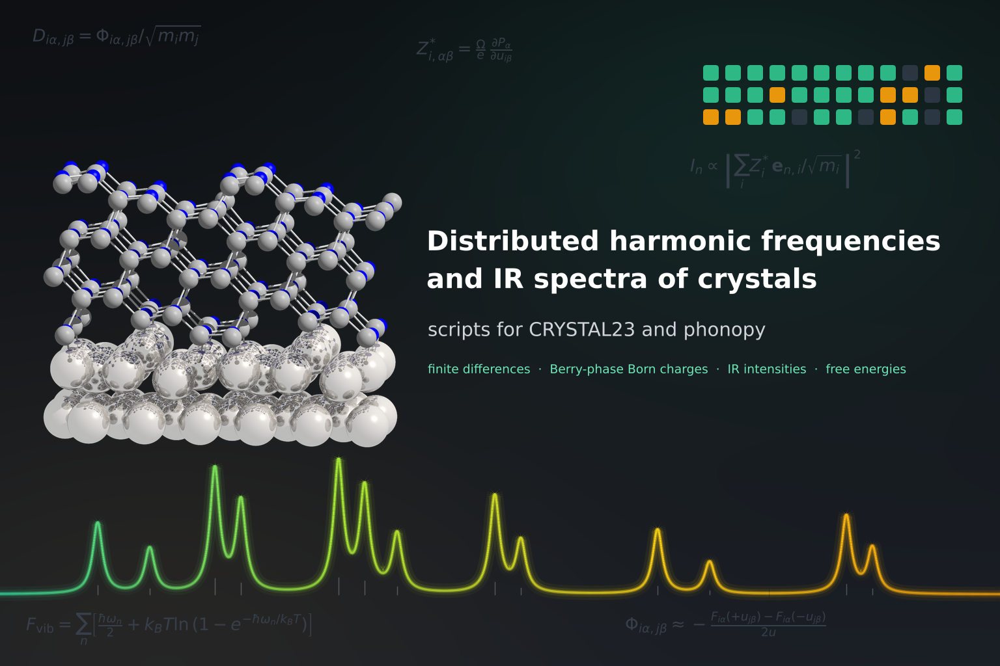

# crystaltools



crystaltools is a collection of scripts that computes harmonic vibrational frequencies, Born effective charges and IR spectra
of crystals with CRYSTAL23 and phonopy. Every displaced structure is an independent CRYSTAL
single point, so the calculation runs as a job array on a queueing system: tasks are short,
run in parallel, and an interrupted task is simply repeated. The force constants are passed to
phonopy for the symmetry analysis, the IR intensities come from Berry-phase polarizations, and
vibrational free energies are available from the same data.

CRYSTAL23 has its own, well-tested frequency module (`FREQCALC`), which we use as the
reference. crystaltools complements it for large, low-symmetry or spin-polarized cells, where
splitting the work into many independent jobs is more practical than one long run.

crystaltools is an independent project. It is not part of CRYSTAL and is not developed or
endorsed by the CRYSTAL developers; it only prepares CRYSTAL inputs and reads CRYSTAL outputs.

## Authors

(to be added)

## Features

* Symmetry-reduced ±displacements with phonopy, one CRYSTAL single point (`GRADCAL`) per displacement
* SLURM job arrays with a limit on simultaneously running tasks; finished steps are skipped on restart
* Born effective charges from the Berry-phase polarization (`POLARI` + `SPOLBP`), also for open-shell cells
* Frequencies, irreducible representations, IR intensities, broadened spectra
* Mode character: share of every set of symmetry-equivalent atoms in each mode
* Zero-point energy and harmonic free energies (Γ point or phonon DOS) and their differences between structures
* Comparison with a classical `FREQCALC` output
* Restart of interrupted geometry optimizations from the last geometry (`restart_opt.py`)

## Requirements

* CRYSTAL23 (`Pcrystal` and the serial `properties` program) — license required, see https://www.crystal.unito.it
* SLURM
* Python 3.9 or later with NumPy, phonopy (installs spglib) and matplotlib

## Installation

```
git clone https://github.com/thequantumchemist/crystaltools.git
cd crystaltools
pip install -r requirements.txt
```

There is nothing to compile. Tell the scripts where CRYSTAL is, either by editing the
`SITE SETTINGS` block at the top of `cryfreq.py` and the `SETTINGS` block of `polar_array.sh`,
or by setting

```
export CRYFREQ_CRYSTAL_ENV=/path/to/utils23/cry23.bashrc
export CRYFREQ_RUN_PCRYSTAL=/path/to/utils23/runPcry23
export CRYFREQ_PARTITION=normal          # SLURM partition
export CRYFREQ_MEM_PER_CPU=6400M
```

Check the installation with the self-test (seconds, no CRYSTAL needed):

```
cd examples/corundum/selftest
python ../../../cryfreq.py setup --geom fake_opt.out --input ../02_freq_classic/struc.d12
python gen_fake.py
python ../../../cryfreq.py analyze --dipoles dipoles.dat --compare fake_freq.out
```

The last line should report deviations of about 0.01 cm⁻¹.

## How to

You need an optimized structure (CRYSTAL output of a `FULLOPTG` run) and a CRYSTAL input with
the basis set and Hamiltonian to use, for example a `FREQCALC` input. Its geometry block,
including `FREQCALC`, is replaced automatically.

**1. Create the displacements** in a new folder

```
mkdir freq && cd freq
python /path/to/cryfreq.py setup --geom ../opt/struc.out --input ../freq_input.d12 --cores 64 --time 06:00:00
```

This writes `ref/` (undisplaced) and `disp-001/ … disp-N/`, each with `struc.d12` and
`struc.gui`, and the job script `run_array.sh`.

**2. Run the single points**

```
sbatch run_array.sh
python /path/to/cryfreq.py status        # shows which tasks are finished
```

**3. Born charges for IR intensities** (after step 2 has finished)

```
cp /path/to/polar_array.sh .
bash polar_array.sh                      # not sbatch - the script submits itself
```

`POLARI` runs for every structure, then `SPOLBP` for every displacement, at most ten at a time.
Run the same command again after time-outs; finished steps are skipped.

**4. Analyse**

```
python /path/to/cryfreq.py analyze --polar
```

**5. Optional: free energies**

```
python /path/to/cryfreq.py thermo --mesh 4 4 6
python /path/to/cryfreq.py compare ../structureA/freq ../structureB/freq --at 0 300 1100
```

## Important settings

| Command / option | Default | Meaning |
|---|---|---|
| `setup --dist` | `0.01` | displacement in Å (`FREQCALC` uses 0.003) |
| `setup --no-pm` | off | one-sided displacements where symmetry allows |
| `setup --par` | `6` | simultaneously running array tasks |
| `setup --no-polar` | off | skip the Berry-phase step in the job script |
| `analyze --polar` | off | Born charges from `disp-XXX/spolbp.outp` |
| `analyze --born` | – | Born charges from a file (natoms × 9) instead |
| `analyze --fwhm` | `10` | Lorentzian width of the spectrum / cm⁻¹ |
| `analyze --compare` | – | `FREQCALC` output for a mode-by-mode comparison |
| `thermo --mesh` | Γ only | q-point mesh for the phonon density of states |
| `MAX_PARALLEL` (`polar_array.sh`) | `10` | simultaneously running Berry-phase tasks |

Converge the SCF tightly (`TOLDEE 10`) and use the same Hamiltonian as in the optimization;
`NEWK` of the Berry-phase runs is taken from `SHRINK` automatically.

## Output

| File | Content |
|---|---|
| `frequencies.dat` | modes, wavenumbers, irreducible representations, IR intensities |
| `mode_character.dat` | share (%) of each set of equivalent atoms in every mode |
| `born_charges.dat` | Born effective charge tensors |
| `ir_spectrum.dat`, `.png` | broadened IR spectrum |
| `thermo.dat` | E_ZPE, F_vib, U_vib, S_vib, C_V versus T |

The scripts in `plotting/` make publication figures from these files; all their settings are in
a header section.

## Example

`examples/corundum` contains a complete test for α-Al₂O₃ (HSE06): the optimization, the classical
`FREQCALC` reference and the crystaltools route. The two agree to 1.4 cm⁻¹ on average and the
intensities of the strong modes to 0.2–2 %.

## Theory

Force constants are obtained by central finite differences of analytical forces,
Φ ≈ −[F(+u) − F(−u)] / 2u, symmetrized with phonopy, and the frequencies follow from the
dynamical matrix D = Φ / √(mᵢ mⱼ) at Γ. Born charges are Z*ᵢ,αβ = (Ω/e) ∂P_α/∂uᵢβ, with the
polarization change from the Berry phase, reconstructed with the site symmetry and corrected for
the acoustic sum rule. IR intensities are Iₙ = (πN_A/3c²) |Σᵢ Z*ᵢ eₙ,ᵢ / √mᵢ|².

## License

This project is licensed under the GPL-3.0 License. See the LICENSE file for details.

## Citation

Please cite CRYSTAL23 (doi:10.1021/acs.jctc.2c00958), phonopy (doi:10.1016/j.scriptamat.2015.07.021,
doi:10.1088/1361-648X/acd831), spglib (doi:10.1080/27660400.2024.2384822) and the crystaltools
paper (in preparation).
